# Desktop UX ("Folio")

How the desktop app looks and behaves. Terms follow `CONTEXT.md`.

The reference implementation is the throwaway prototype in `prototypes/editor-spike/` (one file, `src/main.rs`).
- **To see a screen:** run `cargo run --release` in that folder, or snapshot a named scene with `--snap out.png --scene NAME`. The scenes are listed at the bottom of `main.rs`.
- **What to take from it:** its layout, values and behaviour.
- **What not to take:** its code structure, which is one file of state and view with no domain layer.

Screenshots are in `docs/design/img/`.

## Idea

Cipher is a book you read, not an editor you operate. One Chapter sits on paper in a serif face, and the translation machinery lives in the margins. You fix as you read: select, type what it should say, keep reading, and review when ready.

## Shelf

The home screen: `cipher` opens here, and the library icon at the top of the contents sidebar (or Ctrl+O, or "All books" in the palette) comes back here, closing the Book.

- **The Books are objects.** Each stands face-out as a cloth hardcover, 148 × 212: a muted cloth colour fixed by its file name (oxblood, forest, navy, ochre, plum, slate, teal, umber), a hinge crease near the spine, light falling from the head, the title in cream foil inside a thin blind-stamped frame, and its Source Language as a small stamped mark at the foot (한, 日, 中). Two shadows, contact and ambient. Clicking opens it.
- **Restraint.** No wood grain, textures, bevels or gloss: the realism is light, shadow and proportion. Colours mix in Oklab so a small tint stays small.
- **Rows of five stand on a quiet ledge,** with a museum-card label under each Book, two short lines that never run past the cover ("94 chapters" / "All translated", or "No chapters yet" / the language), a progress hairline, and the path, for a Book from elsewhere.
- **The last slot is empty:** a recessed outline with "+ New book" (or Ctrl+N). Pressed, it becomes a blank cover in the cloth the new file will get, with the caret on it: the title is typed straight onto the cover in foil, centred, and the label underneath turns into "WRITTEN IN" with three stamps (한 Korean, 日 Japanese, 中 Chinese; the chosen one is stamped at the cover's foot), Create and Cancel. Enter creates the Book and opens it on its first chapter's page; Esc puts the cover away. No sheet.

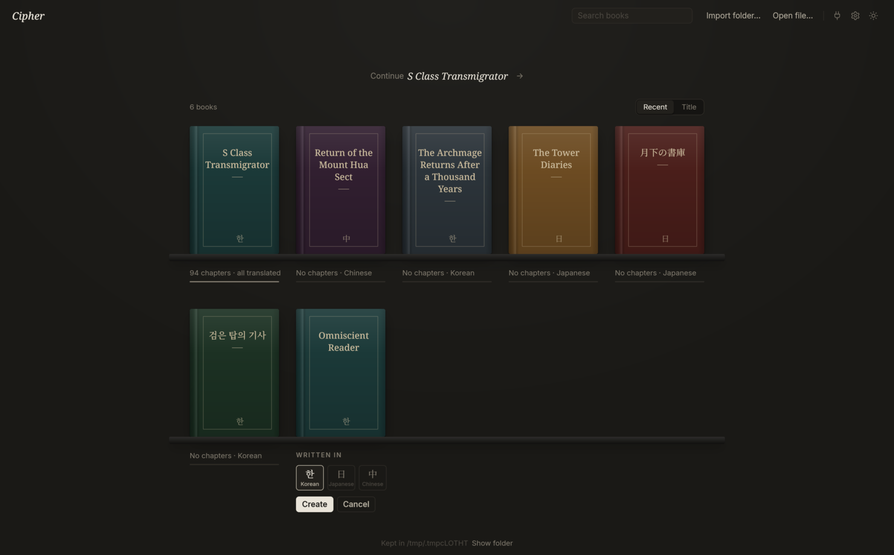
- **"⋯" on a cover (on hover), or right-clicking it,** opens Open, Show in Files, Rename… and Move to Trash… (Remove from shelf for a Book from elsewhere, which never deletes the file); Rename and Remove confirm in the label's place.
- **Header** (it drags the window): the Cipher wordmark, a Search books field (filters by title; no match says so), bordered Import (a folder) and Open (a .cipher file) buttons and a filled New book button (Ctrl+N), Endpoints and models, Settings, and the theme toggle. Without an XDG file chooser portal, Import and Open ask for a typed path in a sheet.
- **Above the shelf:** "Continue *Title* | Chapter N →" on one baseline, a hover-lit button, for the Book read last, then the count of Books and a Recent / Title sort (remembered).
- **Labels** read "Chapter N of M" once a Book has been read.
- **Motion:** pages change in place. Switching screens, Chapters, panels, Shelf and Book, or Settings sections never fades or slides (`instant_changes` on the page areas); only menus, sheets and toasts fade.
- **Empty Chapters** (no source text, usually missing from an import) are marked "empty" in the contents and the scrubber, are left out of the waiting count, and say so on their page instead of offering Translate.
- **Footer:** "Kept in ~/Documents/Cipher · Show folder".
- **Dropping** a `.cipher` file on the window opens it (it joins the Shelf); dropping a folder imports it.

An empty Book opens on the page for its first chapter (Adding chapters).

## Welcome

The first run, while the Shelf is empty, opens a title page instead of the Shelf: "Cipher" large in italic serif, "Read web novels in your own language.", a short paragraph on what the app does, then two numbered steps, each done in place:
1. **Connect a model.** Two cards, Sign in with ChatGPT and Use an API key; choosing one opens the Endpoint form (as in Settings) right there. Once saved the step reads "✓ Endpoint · model".
2. **Start your first book.** The blank cover from the Shelf, typed on, with the language stamps and Create; beside it "Already have chapters?" with Import a folder of chapters… and Open a .cipher book….

Creating, importing or opening a Book, or "Skip, go to the Shelf →", ends it for good (`prefs.json` `onboarded`). Settings › About › Welcome shows it again. People who already have Books never see it.

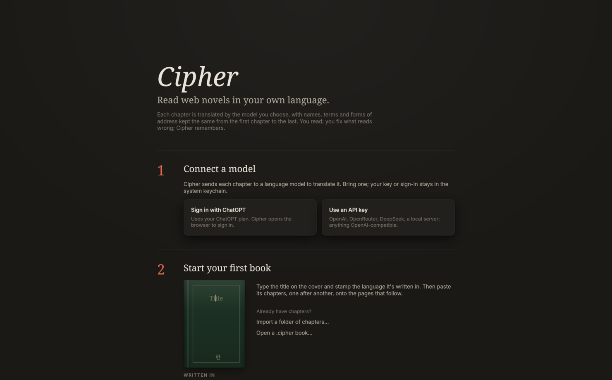

## Layout

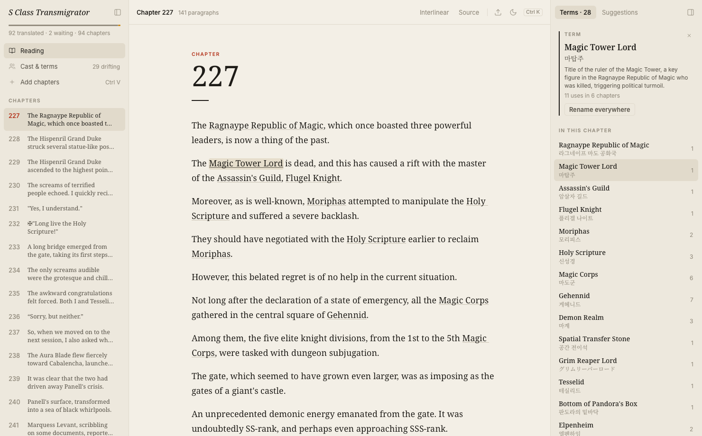

Three columns, each with a 52px header row so the headers line up.

**Contents (left, 272px, Ctrl+\\)**
- **Header:** the Book title (serif italic) and a hide button.
- **Progress:** one hairline bar (translated in ink3, waiting in amber) and the line "92 translated · 2 waiting · 94 chapters".
- **Pages:** Reading, Cast & terms (with its drifting count), Style and New chapter (Ctrl N).
- **Chapter list:**
  - each row shows the number in tabular figures, the Chapter's opening line (two lines, serif) and badges;
  - badges: a red count of pending Proposed Edits, an amber dot for waiting to translate;
  - the current Chapter has a selected fill and a red number;
  - the list scrolls to follow the current Chapter.

**Page (centre)**
- **Header:** the Chapter, its state ("141 paragraphs · gpt-6-luna", "158 paragraphs · imported", "waiting to translate", "source", "queued to translate again"; its tooltip says who translated it, when, and the tokens in and out), then the Interlinear and Source toggles, Publish, the theme toggle and a Ctrl K hint.
- **Reading column:** 640px of text with a 56px gutter on its left, centred in the remaining space.

**Context (right, 320px, Ctrl+J)**
- **Two tabs:** Terms · N and Suggestions · N.
- **Terms tab:**
  - the selected Term's card on top;
  - then "In this chapter": every Term in order of first appearance, with its source form, its count here and a red dot if drifting here. A Chapter not translated yet lists "In the source" instead: the Terms its source names, with how often, so the names it will get are visible before translating.
- **Suggestions tab:** grouped "This chapter" and "Elsewhere". Elsewhere items carry a "ch 231" link to the paragraph.

**Sidebar widths:** drag an inner divider, or Tab to it and use ← / → to move it (Home sets the minimum width; End uses the available room). Each width is remembered independently and resizing keeps the current reading position.

**Narrow windows:** the sidebars reserve 520 points for the reading column. If both chosen widths don't fit, the last-opened sidebar has priority and can narrow to fit; either can give way when there isn't enough room at the current interface zoom. The show buttons stay in the header, and the chosen widths return when there is room again. At very narrow sizes the page itself shrinks to fit.

**Focus layout:** hide either sidebar and the page takes the room.
- With the context sidebar hidden, notes move into a 260px page margin beside their paragraph, absolutely positioned so they never push text apart.
- With the contents hidden, a 44px chapter scrubber runs down the window's left edge:
  - one tick per Chapter, with a longer tick and label every ten;
  - the current Chapter in red, earlier ones in ink3, waiting ones in amber, ones with pending edits in soft red.

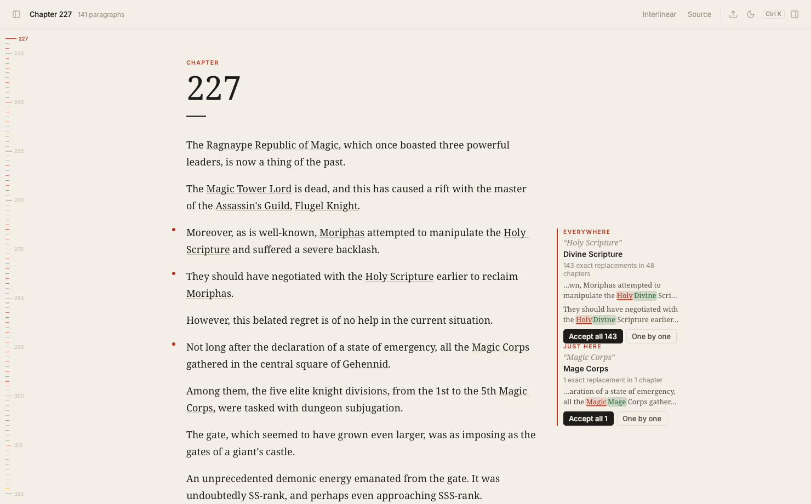

## The page

- **Opener:** a red tracked label "CHAPTER", the number set at 60px light serif, and a 36px rule. There is no title and no counts.
- **Paragraphs:** serif 18/31 with 18px between paragraphs. A Translation's leading `# Chapter N:` heading Block is not shown, since the opener replaces it.
- **Glossary Terms:**
  - a faint underline; hover shows the source form and definition as a tooltip, with a tinted background;
  - click opens the Term in the context sidebar;
  - the selected Term stays tinted wherever it appears.
- **Gutter:** one click target per paragraph that unfolds its source inline (CJK serif 14/23, muted). A languages icon shows on hover. A red dot replaces it when the paragraph has pending edits.
- **Interlinear (Ctrl+I):** the source under every paragraph.
- **Source (Ctrl+T):** the whole Chapter in the Source Language. Switching keeps the reading position by Pair.
- **Continuous reading:** the page holds the current Chapter and its neighbours, so scrolling runs from one Chapter into the next both ways. The Chapter crossing a line 300 points down the window is current: the header, the contents list and Ctrl+T follow it. While the page moves, only the next Chapter is added below; once it has been still for 0.25 s the strip becomes the current Chapter ± 1, holding the current one where it is (Rune lets wheel input beat its scroll hold, so changing what is above mid-scroll would jump the page).
- **Type:** the reading face, size, line spacing and column width come from Settings › Reading or the header's "Aa" popover (Size A/A, Serif/Sans, Tight/Normal/Loose, Narrow/Medium/Wide, and the theme), applied at once.
- **End of Chapter:** a quiet line "Chapter 228 →", not a card.
- **Waiting Chapter:** a card "Not translated yet" with **Translate** and, when later Chapters wait too, **Translate all N from here**, then the source text.
- **Translating Chapter:** the card reads "Translating now · 50 of 143 paragraphs", and each paragraph appears above its source as it arrives, so progress can be read, not just counted.

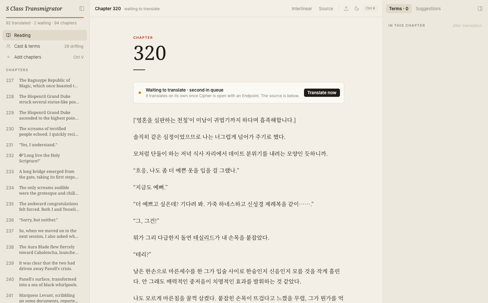

## Fixing while reading

1. **Select text.** A dark chip "Suggest a fix · or just start typing" appears under the paragraph. Selecting to copy is never blocked.
2. **Type to start.** Typing a letter or clicking the chip opens the fix box with that letter in it.
3. **The fix box (640px):**
   - the highlighted quote → an input "What should it say? Or say what's wrong.";
   - the source line underneath, or "source · glossary term" for a known Term;
   - a row of choices: a **Rename** checkbox, then the Scope chips "Just here", "Everywhere · 10 in 6 ch" and "Everywhere + glossary" for a Term or "From now on" otherwise;
   - keys: Tab cycles Scope, Enter sends, Esc closes.

   The defaults: a selection of four words or fewer starts as a Rename, and a known Term starts on "Everywhere + glossary".
4. **The Suggestion becomes a note** in the context sidebar, or in the margin when that is hidden. A note shows:
   - its Scope label in red;
   - the quote in italic;
   - what the user said;
   - a status line.

   You keep reading while Cipher works.
5. **Review, two ways:**
   - **Rename:** "143 exact replacements in 48 chapters", two diff samples, then **Accept all 143** and "One by one".
   - **Model-written edits:** **Review** and "Accept all".
   - Paragraphs the model left as they were (a SKIP, or an answer the local checks turned down) are one status line with the first reason, "12 left as they are · “already names it”". They are never stepped through, and are dismissed with the last decision; a note holding only those offers **Dismiss**.
6. **One by one, inline:**
   - the current paragraph gets a tinted block with its source line above;
   - the paragraph shows in full twice, like source above translation: NOW, with deleted words red and underlined, then PROPOSED, with inserted words green. Other paragraphs of the Suggestion in view show the compact inline diff;
   - a dark bar at the bottom reads "“Holy Scripture” → “Divine Scripture” · 3 of 143 · Chapter 231", with buttons for previous, next, skip (X), accept rest (Shift+A) and accept (A, red);
   - J and K move;
   - Esc returns to where you were reading;
   - review crosses Chapters, and the contents list follows.
7. **After review:** a toast summarises the result ("142 applied, 1 changed since") and the note offers **Undo**.

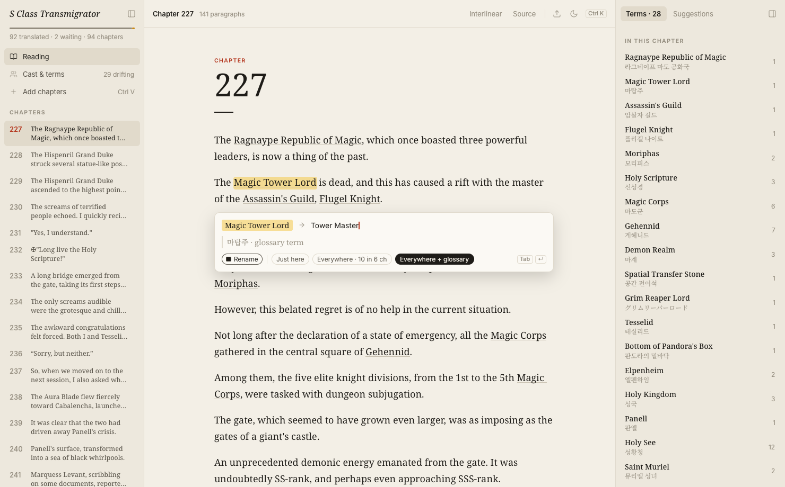
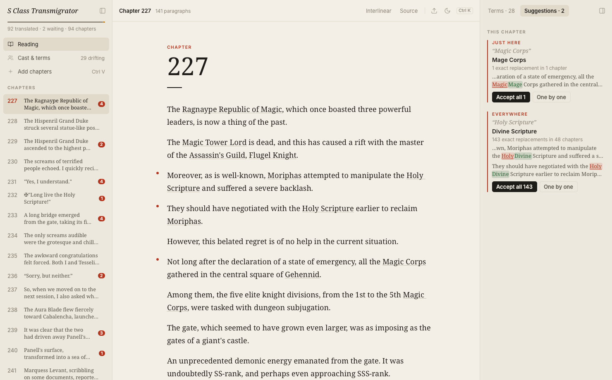
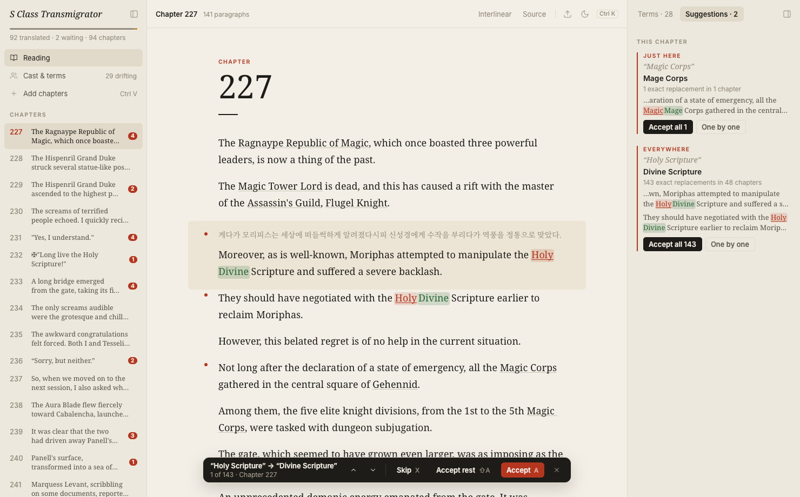

These rules apply to Suggestions:
- **Review open while a Chapter finishes translating:** when the Review is applied, Cipher searches again and adds the newly translated Blocks as more Proposed Edits.
- **Block changed after its edit was proposed:** that Proposed Edit is stale and offers regeneration. It is never applied over the newer text.
- **Undoing a Revision whose Blocks were later edited:** the untouched Blocks are reverted and the edited ones are shown as conflicts.
- **Retranslating a Chapter:** Blocks with Hand Edits are kept by default, with an option to retranslate them too.

## Cast & terms (Ctrl+G)

The Glossary as a page the Book fills in itself.
- **Header:** "224 terms" and the drifting count, then a search field (rendering, source form or a forbidden wording) and a **Drifting only** filter, and labels over the columns (Term, Uses, Across the book).
- **Order:** Terms drifting in the most Chapters first, then by use; a long Book has many Terms missed in one Chapter of hundreds, which sink below the real problems.
- **Each row:**
  - the rendering (serif);
  - the source form, plus "never X, Y" for its Forbidden Renderings;
  - total uses ("–" when the translation never uses the rendering);
  - a sparkline of use across the Book (block characters, DejaVu Sans Mono 7.5px; at most 48, so a long Book sums runs of Chapters into each);
  - a red "drift · N ch" chip, or "may go unnamed".
- **Opening a row** (click) shows what the drift is ("A forbidden wording appears 12 times in 5 chapters", "Left unnamed in 3 chapters…") and the drifting Chapters as number chips that open them. Below, **How the book names it** ("1,334 paragraphs name 마력사"; "Reading the Book…" for the second it takes), one entry per wording (`translation-pipeline.md` › What the Book calls a Term):
  - the glossary's rendering first, then up to five other wordings, each with its paragraph count, chapter range ("ch 245–1494"), "forbidden" or "also 판데모니엄 = Pandemonium" where it applies, and **Examples**: two Pairs, source above translation, the wording highlighted;
  - a **Same name?** chip on each other wording (Forbidden Renderings start marked) and **Keep · N changes** on the rendering and on each marked wording, N being the paragraphs that choice rewrites ("Keep · 895 changes" against "Keep · 272 changes" says which half of the Book to rewrite). Keep sends one From now on Rename, reviewed under Suggestions;
  - "N paragraphs name it neither way, often with a pronoun" with **Ask the model** (opt-in);
  - **It can go unnamed** (or **Check it again**).

  While a rename or a model request is open, the panel says what it holds and offers **Review**. Rows have no tooltip: Rune keeps a tooltip up through a press, and it would cover the panel that opens. The Term card in the reading sidebar has the same panel.

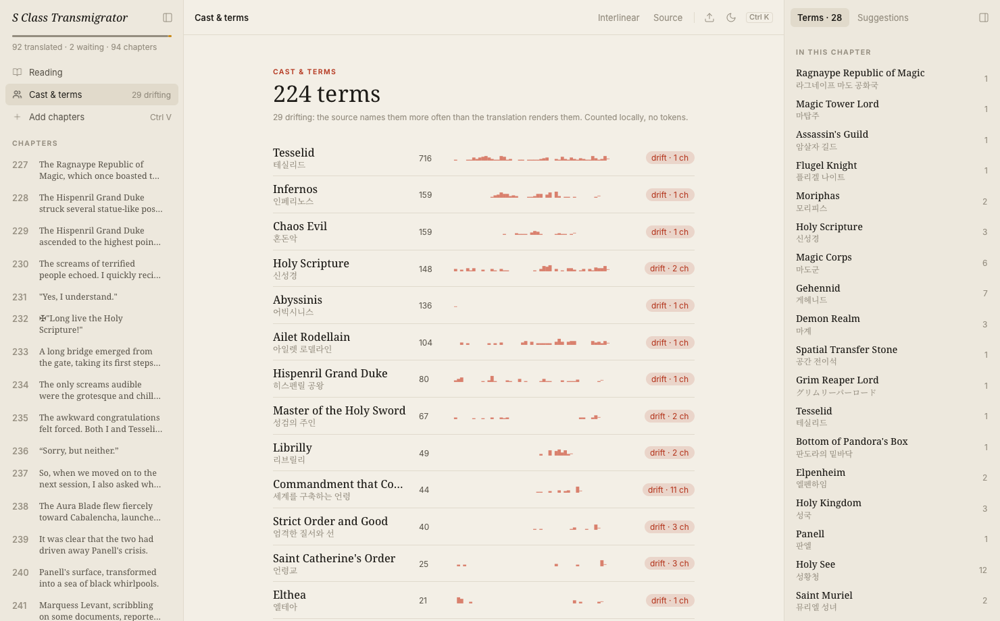

## Style

The Book's Style Rules as one page (nav row "Style", the palette, `view/style.rs`): "How this book should read", a line on what it is for, and one serif text field holding every rule, a paragraph or list item each (`cipher_engine::style_rules`). The rules go with every Chapter's translation, before the glossary; From now on fixes add theirs here. Save (Ctrl+S) writes them as one Revision and says chapters translated from now on follow it; Revert puts back what is saved; Esc returns to reading, keeping unsaved text for the next visit. Importing a folder brings `style.md` in whole, a paragraph or list item per rule, headings dropped.

## Adding chapters

A new chapter is a page in the Book, not a dialog. It opens from "New chapter" in the contents sidebar (Ctrl+N), from "Add chapter N →" after the last chapter, from the palette, or by pasting (Ctrl+V outside a text field); an empty Book opens on it. The header says "New chapter", the reading toggles and the context sidebar step aside, and the contents list keeps a "Chapter N · draft" row at its end.

The page is set like a chapter's opening page:
- "NEW CHAPTER" in red, then the number: the one read from the text (화/話/章/Chapter in the first lines) in ink, or the next free number in faint ink until one is read; the title in italic if the heading has one; the rule.
- Under it, what Cipher makes of the text as it changes: "4 paragraphs · goes after chapter 320", or how to give it a number; a warning in amber when it has no number (it goes at the end) and in red when that chapter is already in the Book.
- Without a model, a quiet card: "Chapters are kept as you add them and translated once a model is connected" with Connect a model.
- The source itself, pasted or typed straight onto the page in the source face; the placeholder is a line of Korean.
- Below a rule: **Add chapter N** (Ctrl+Enter; faint until there is text), Discard (Clear in an empty Book), and Open a text file… (`.txt`, `.md`), which fills the page from a file.

Adding inserts the chapter in number order, queues it and opens it where it landed. Esc goes back to reading and keeps the draft for later; pasting while a draft exists adds to it. When the clipboard already holds a chapter, New chapter starts the page with it.

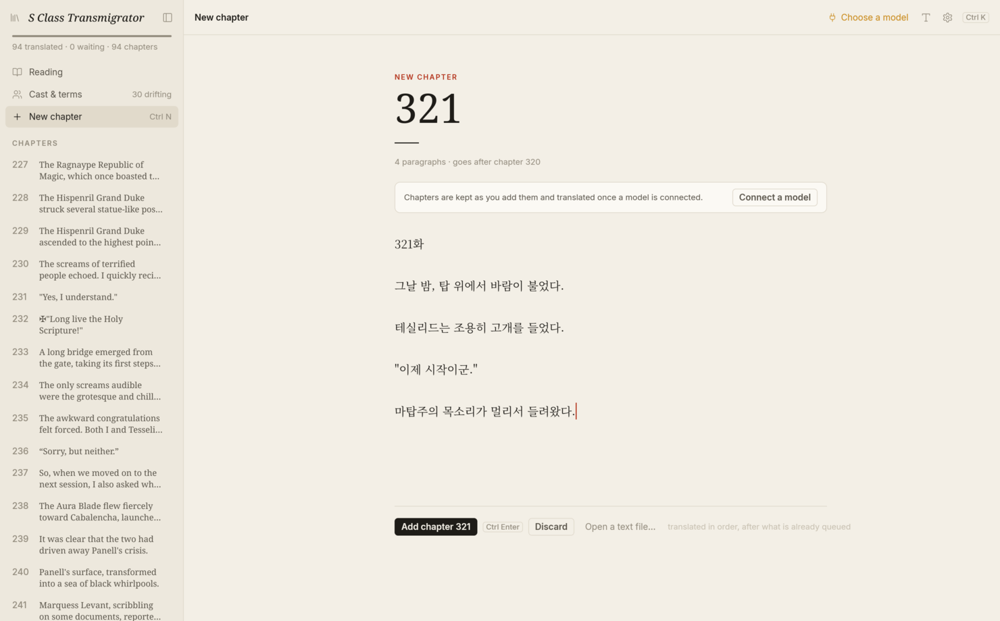

## Palette (Ctrl+K)

A 600px sheet over a scrim, 110px from the top. It finds:
- actions: Cast & terms, Style, Suggestions, Show source, Interlinear, Dark/Light mode, Publish to Reader, Add chapters;
- Chapters by number, shown with their opening line;
- Terms by rendering or source form.

Enter runs the first result.

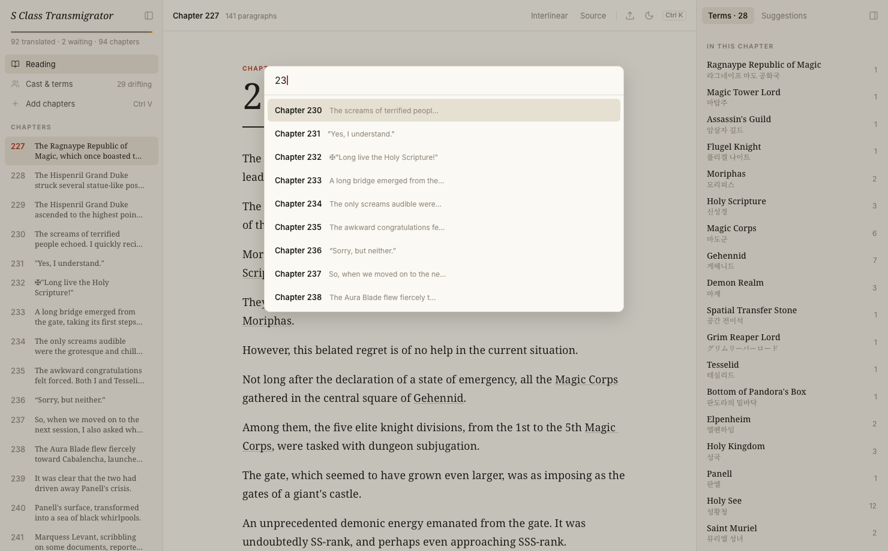

## Keys

The full list lives in one table, `crates/cipher-app/src/keys.rs`; the shortcuts sheet (Ctrl+/ or F1) and Settings › Shortcuts show it. Besides the ones below: Ctrl+, Settings, Ctrl+O or Ctrl+W the Shelf, F11 full screen, Ctrl+Q quit, Space / Shift+Space a screen down / up, Alt+→ / Alt+← next / previous Chapter, Ctrl+= / Ctrl+- / Ctrl+0 text size. Esc closes the topmost sheet, popover or menu.

| Key | Action |
|---|---|
| Ctrl+K | Palette |
| Ctrl+\\ | Contents sidebar |
| Ctrl+J | Context sidebar |
| Ctrl+G | Cast & terms |
| Ctrl+I | Interlinear |
| Ctrl+T | Source / Translation, keeping position |
| Ctrl+D | Dark / light |
| Ctrl+V | Add a chapter from the clipboard |
| Typing with a Selection | Opens the fix box |
| Tab / Enter / Esc in the fix box | Scope / send / close |
| J K A X Shift+A Esc in review | Next, previous, accept, skip, accept rest, leave |

## Look

**Type**
- **Book text:** Noto Serif 18/31 by default, with Noto Serif CJK KR for source text (a point smaller, same leading; interlinear 14/23). The reader can change face (Serif or Noto Sans), size (14–26), leading (1.5, 1.72, 1.95 × size) and column width (560, 640, 760). Families are given as lists so CJK falls back within a run.
- **Interface:** Inter (Rune's sans) at 13 regular, 13/550 for emphasis and 12 for small text.
- **Labels:** 10.5/650 with 1.4 tracking, uppercase.
- **Chapter number:** 60/300 serif.

**Shape**
- Radii: 6px for buttons and rows, 10px for cards, 12px for the review bar, 15px for the chip.
- Hairline 1px rules. Shadows only on floating things (`0 10 30` at the shadow colour).

**Colour roles**

| Role | Light | Dark |
|---|---|---|
| paper (page) | #F3EFE6 | #1A1916 |
| side (sidebars) | #EDE8DD | #151412 |
| card | #FBF9F4 | #22201C |
| ink / ink2 / ink3 / ink4 | #1E1C18 / #5B564C / #948D7F / #C9C2B3 | #E9E4D9 / #B5AE9F / #7F796D / #4B4740 |
| rule / hover / selected | #E0DACD / #E6E0D3 / #E1DACB | #2D2A25 / #26241F / #2E2B26 |
| red (marks, current, accept) / soft / tint / on-red | #B4361E / #D9806D / #B4361E24 / #FFF6F2 | #E5694C / #A65141 / #E5694C2B / #1A1916 |
| green (inserted) / tint | #2E6A3A / #2E6A3A2E | #86C496 / #86C4962B |
| amber (waiting) | #C98A1B | #D9A13A |
| highlight (selection) | #F4C84A8C | #D9A93E5C |
| term tint / review focus | #E6DECC / #ECE5D5 | #312D27 / #23211D |
| bar (chip, review) / fg / fg2 / hover | #1E1C18 / #F3EFE6 / #A39C8E / #3A3730 | #2C2A25 / #E9E4D9 / #8F887B / #3A3731 |
| scrim / shadow | #1E1C1838 / #1E1C1830 | #00000080 / #00000099 |

Primary buttons are filled with ink and use paper for text, so they flip to light in dark mode.

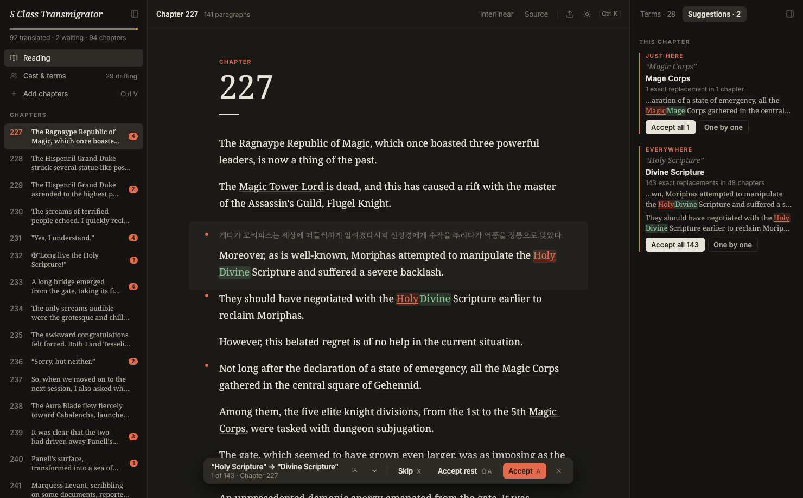

## Feel

Cipher should feel like a native app, not a web page. The user asked for this explicitly (2026-11-11).
- **Inertial scrolling everywhere:** every scroll view (page, Contents, Context, Cast, palette results) coasts after a trackpad swipe and eases to a stop. Mouse-wheel steps glide rather than jump. Keyboard scrolling (Page Up/Down, Space, Home/End) glides too. Edges rubber-band where the platform does.
- **Where it lives:** in Rune, not in Cipher's views, so every scroll view gets it. Rune already decays a scroll velocity (`fling`) and has glides and rubber-band helpers (`rune-motion`), but on Linux it applies wheel and trackpad deltas 1:1 and relies on the OS for momentum, which only macOS supplies. Missing: on a trackpad gesture's end with no OS momentum, hand the tracked velocity to the decay; turn line-step wheel deltas into glides. Checked against `a7f276c` and again after updating to `8fc71fb` (2026-11-14): still missing. That update made a Linux wheel line 120 points (was 40) and gave Wayland touchpads a 12× gain via the patched winit, to match Chromium; touchscreen pans now fling and rubber-band, but wheel and touchpad do not. `Tx::scroll_to_with` takes a spring for keyboard glides.

## Settings

Ctrl+, (or the gear in the reading header and on the Shelf) opens the Settings window over a scrim: at most 920 × 640, a section list on the left (General, Reading, Translation, Shortcuts, About) and the section on the right. Esc, ✕ or a click outside closes it. Each setting is a row: name and a line about it on the left, the control on the right, and ↺ beside it when it differs from the default.

Everything except an Endpoint applies the moment it changes, and is saved to `prefs.json` beside `endpoints.json` (written atomically; unknown or missing fields fall back to defaults):
- **General:** Appearance (System, Light, Dark; System follows the desktop live through the XDG portal's color-scheme, which Rune reads), Interface size (80–160%, `Cx::zoom`), Reopen the last Book (on by default), Books folder with Show.
- **Reading:** Typeface, Text size, Line spacing, Column width, and a preview paragraph.
- **Translation:** the Endpoints, below.
- **Shortcuts:** the key table. **About:** version and where settings live.

The quick switches (Ctrl+D, the theme item in "Aa") choose the other look; choosing the one the desktop already has goes back to following it.

## Endpoints and models

All connection and model setup lives in Settings › Translation; a Book only picks a model.
- **The list:** every Endpoint, with its URL (or "ChatGPT plan"), its default model and how many more. The default Endpoint says so; the others have Make default. Edit loads one into the form; Remove forgets it and its keychain key (Books that chose it fall back to the default). "+ Add Endpoint" starts a blank form.
- **The form:** API key (base URL, key, Chat Completions or Responses) or Sign in with ChatGPT; Default model (for a signed-in plan, "Models on your plan" lists the models the backend offers, fetched when the form opens, and one click makes one the default), optional Small model, "More models Books can choose" (comma-separated), reasoning effort chips (Default, Minimal, Low, Medium, High), optional name (else the URL's host, or "ChatGPT").
- **Test** makes one tiny call with the key as typed and shows the reply, time and tokens. **Save** stores the key in the OS keychain and the rest in `endpoints.json` and restarts the worker. Save is explicit here, unlike the rest of Settings, so a half-typed key is never used. Revert drops what was typed. The first Endpoint saved becomes the default.

**The Book's model:** the reading header shows what the open Book translates with ("api.example.com · model-medium"; amber "Choose a model" when there is no Endpoint; red "Model unavailable" with the reason as tooltip). Clicking it opens a menu: "Default · Endpoint · model", then each Endpoint's models under its name, a check on the chosen one, and "Endpoints and models…" to Settings. The choice is stored in the Book; picking one restarts the worker on it.

## Desktop

- **Identity:** app id `app.cipher.Cipher` (Wayland app_id, X11 WM_CLASS, the desktop entry and icon names). One instance: a later launch hands its `file://…/x.cipher` link to the running window, which opens that Book. Desktop entry, MIME type, icons and AppStream data are in `packaging/linux/` (`install.sh` installs them for the user).
- **Window:** opens at its last size (minimum 760 × 520); the native frame stays (tiling window managers keep control), and the reading and Shelf headers also drag the window, double-click maximising.
- **Remembered:** appearance, reading type, interface size, the sidebars' visibility and widths, the Shelf's sort, the window's size, the open Book (reopened at launch unless turned off) and, per Book in `shelf.json`, the Chapter and the paragraph at the top of the window.
- **Right-click:** a Shelf cover (its menu) and a Chapter in the contents (Open; Translate and Translate all N from here when it waits, Translate again when it is translated, Retry when it failed). Translate again keeps the current translation until the new one is written, says so in a toast, and the header reads "queued to translate again", then its progress.
- **Toasts** go by themselves after five seconds plus a little per word (ten with Undo); ✕ closes one sooner.
- **Drop** a Book or a folder anywhere on the window (see Shelf).

## Queue and failures

- **Header:** while another Chapter translates, "• Chapter 321 · 12 of 141" sits before the model menu and opens it; on the translating Chapter itself the header state reads "translating · 12 of 141". A usage-limit pause shows "Paused · resumes in 42 min" with the reason as a tooltip; an Endpoint that could not connect shows "Endpoint unavailable".
- **Untranslated card:** Waiting has **Translate**, Failed shows its reason and **Retry** (the Job keeps its progress and its place, so it runs next), Queued without an Endpoint offers **Set up an Endpoint**, Translating shows its progress.
- **Contents:** a failed Chapter's red dot gives its reason as a tooltip.
- **Flagged Pairs:** an amber gutter dot and a small "Flagged: reason" line under the paragraph.

## Designed but not prototyped

- **Hand editing:**
  - double-clicking a Block, or pressing E on the hovered Block, turns it into a raw-markdown field in place;
  - Esc or clicking away commits it as a Hand Edit Revision;
  - the source is edited the same way in Source view, which marks the translated Blocks Outdated;
  - splitting and merging Blocks are explicit commands that adjust Pairs, never Enter or Backspace at a paragraph edge, because Pairs drive every fix.
- **Per-Chapter token usage** in Endpoint settings or the Chapter header (designed, not built).
- **Follow the system theme** by default.
- **Later:** phone flags (select text in the Reader, sync down as unresolved Suggestions).
